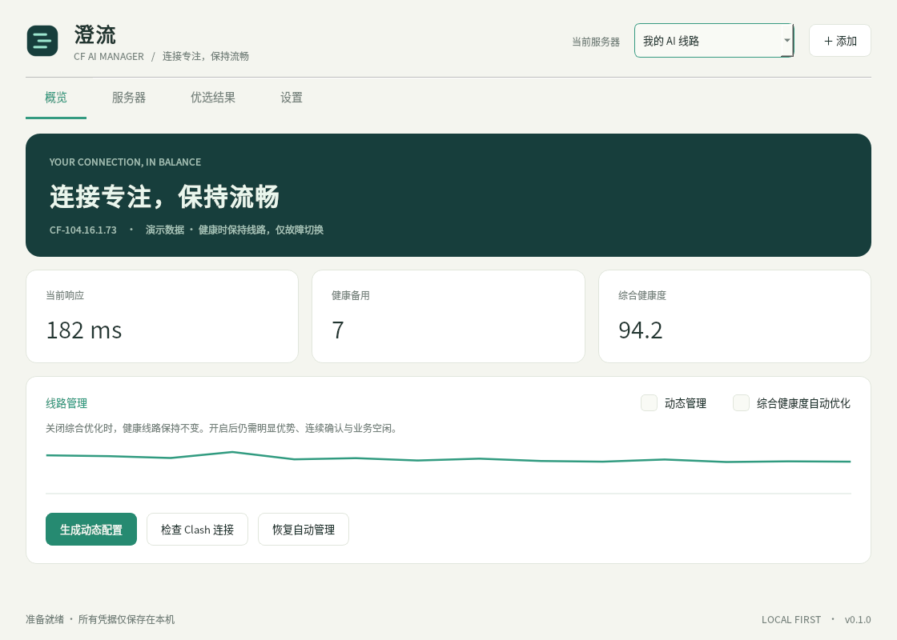

# 澄流 · CF AI Manager

面向 AI 对话与编程的 Cloudflare 入口优选工具。Windows 10/11 x64；管理自己已搭建的 WS+TLS 隧道，不提供代理服务或部署 VPS。

> 0.2.7 预览版。修复手动优选完成后未同步动态节点池的问题，显示同步结果与暂停原因；保留 0.2.6 的网段偏好学习、探索配额与真实隧道验证。源码公开，便携程序可本地构建。



[深色界面](validation/screenshots/overview-dark.png) · [优选结果](validation/screenshots/results-light.png)

## 使用便携版

完整解压 `CFAIManager-0.2.7-windows-x64.zip`，双击 `CFAIManager.exe`。保留旁边的 `_internal` 目录，无需安装 Python。首次启动是空配置，不含任何现成节点。

1. 添加服务器，填写 CF 域名、协议、端口、UUID/密码和 WS 路径。SNI/Host 留空跟随域名。
2. 到“优选结果”点击“开始优选”。使用独立内核验证真实隧道，默认含有限流量的下载测试。
3. **只想导出**：点击“导出静态配置”，选择完整 Mihomo 配置或仅节点文件。文件内嵌凭据，不依赖本工具运行。
4. **需要动态管理**：点击“生成动态配置”，选择 YAML 保存位置（默认下载文件夹）。完成后可复制文件路径，在 Clash Verge Rev 中手动导入、启用该文件，选择该实例 CF 组，再打开“动态管理”。生成后不自动打开资源管理器。工具不会替用户切换现用 profile。
5. 默认仅故障切换；可开启“综合健康度自动优化”。主动优化受连续领先、优势门槛、冷却时间和业务活动保护约束。

配置页面中的 VPS IP 是可选源站信息。Reality 等直连参数不能从 IP 自动推导；可另外导入直连单节点模板。首版表单支持 VLESS、VMess、Trojan 的 WS+TLS。

## 策略与参数

### 国内游戏直连

动态配置和完整静态配置共用同一套分流，参考旧 `tz-nodes.yaml`：内网 / 本机、常见国内游戏及登录 CDN 域名（腾讯、网易、米哈游、哔哩哔哩、完美、金山等）、国内 IPv4 / IPv6 网段直连。UDP 3478 游戏打洞默认直连。国内域名 / 网段放行后才拦截剩余 UDP 443，避免国服游戏的 QUIC 被误伤；AI 域名优先代理，其 QUIC 默认拦截以便浏览器回退 TCP。

“设置 → 调整全部参数 → 导出分流”可关闭国内直连、UDP 3478 直连或 UDP 443 拦截，添加额外直连域名（包括子域）和游戏 EXE 文件名。进程规则会让该进程的所有非 AI 流量直连，适合国服使用境外服务器或专用域名的情况；不要填写通用浏览器 / 启动器，除非希望其全部非 AI 流量直连。规则修改不作废已有测速结果。

国内网段来自 [gaoyifan/china-operator-ip](https://github.com/gaoyifan/china-operator-ip)，2026-10-27 固定快照；随程序和导出文件内嵌，不依赖在线规则订阅或额外 GeoIP 下载。来源、固定提交和 SHA-256 在 `resources/routing/manifest.json`，授权随导出文件保存。快照随程序版本更新，不保证覆盖所有新域名、地址归属或海外服务器；遇到漏网游戏可添加域名 / 进程例外。

修改后重新生成 / 导出，并在 Clash 中导入或重新加载；更新程序不会自动改写此前导出的规则。重新生成正在使用的动态配置时，会先核对现用节点池；有当前网络的有效优选结果时同步更新备用节点，没有结果时沿用现用池。手动生成允许在手动保持或动态管理关闭时明确更新节点池，保留当前线路和活动连接，且不解除手动保持或开启自动管理；节点池不同步时阻止生成。“仅节点文件”没有分流规则，继续使用接收配置的规则。须使用 Clash **规则模式**；全局模式会绕过此分流。

### 节点健康

- 默认当前节点每 15 秒探测，备用每 60 秒；两个 HTTPS 地址复核后，连续失败两轮才视为故障。
- 故障备用需连续成功三轮。控制 API 异常不等于节点故障；未知状态保留线路。
- 默认成功率/连接延迟/首次请求耗时/连接延迟波动/带宽权重为 **60/15/5/15/5**；带宽到 2 Mbps 后封顶。在“设置 → 调整全部参数 → 健康评分”中分别调整权重和参考值，权重为相对比例，0 表示不计入。改变评分参数会直接重排已有双指标结果，不要求重新测速；动态监测会重新收集健康观测。
- 评分中，延迟、首次请求和波动分别使用 `1 / (1 + 实测值 / 参考值)`，各项乘权重后按有效权重归一化为 0–100 分。默认连接延迟参考值 300 ms、首次请求 1500 ms、波动 100 ms。任一参与比较的节点缺少某项证据时，整组统一移除该项，避免缺测节点获得额外优势；没有有效非零权重时显示“数据不足”。
- 开启追优后，默认同一候选领先至少 10 分、连续三轮新观测、至少间隔 30 分钟。故障切换豁免主动优化冷却。
- 用户手动改变受管 CF 选择后进入“手动保持”：继续健康探测和定期发现候选，停止自动切换及节点池发布；点击“恢复自动管理”解除。修改设置或网络变化时，不用旧上下文的预期节点误判新的选择。
- 动态管理开启且本实例动态配置已在 Clash 启用时，手动优选完成会刷新备用节点池，优先加入本轮通过验证的节点；保留当前选择和活动连接正在使用的节点，不因优选完成立即切换线路。后台发现仍仅补充空位或替换长期故障节点。结果页会显示同步结果；手动保持、管理关闭或 Clash 未接入时明确提示未同步原因。处于手动保持时，先在概览点击“恢复自动管理”，再重新优选。
- 首页显示当前节点最近探测、上次完整优选和下次自动优选时间。结果页的验证时间属于完整优选快照，不会因每次健康探测而重写。样本未齐时显示“收集中”，过期指标显示“待探测”。默认完整发现周期为 24 小时，备用不足时可提前补充，未到期并不表示健康探测停止。
- 所有参数在设置中可调整，支持 AI 稳定和多模态/文件预设。下载测试是网络测量，不会发送模型请求或读取浏览器账号。

## 测速、流量和网络

### 搜寻范围与覆盖边界

随包信任列表含 15 段 Cloudflare IPv4，共 1,524,736 个地址；在线刷新优先读取 `/ips-v4`，24 小时内使用缓存，失败时回退缓存或随包列表。在线返回的段必须属于随包信任范围，新增的外部段需随版本核实更新。只扫描服务器配置的一个 HTTPS 端口，不扫描 VPS 出口，不支持 IPv6 入口。

默认每批共测 256 个地址（约为名义地址空间的 0.0168%）。0.2.6 起分配为最多 70% 偏好/复测、至少 30% 新地址探索：256 个名额先保留 **77 个探索地址**，其余最多 179 个用于现用池/同网络历史成功入口复测和好网段的新地址。种子只占偏好额度；偏好名额不足时转为探索。无学习记录或没有有效好网段时，除种子复测外均衡探索各段。网段内使用独立偏移和持久游标，探索部分跨网段轮转；这仍不是按地址空间大小加权的均匀随机抽样。近期地址在同一网络和端口下排除 30 天，最多记 20,000 条；种子可主动复测，批内不重复。排除记录与游标不是永久不重复或穷尽扫描的承诺。

学习只使用完整三轮真实隧道验证：每个网段在一批中最多贡献一份成绩，约 80% 取决于准入比例、20% 取决于成功入口的首次请求、复用连接延迟和波动。加入中性先验以降低少量样本的影响，证据按 **7 天半衰期**衰减，保留最近 30 天、每段最多 32 批。只有存在成功证据且平滑成绩高于中性的段才进入偏好池，选前三段按成绩平方分配新地址，TCP 快而隧道全失败不会获得偏好。一次全失败只增加一批负证据；取消、超时中断、内核故障、网络变化或最终物理出口复核失败不更新成绩。偏好从升级后的完整扫描开始积累，不把旧版结果自动当成学习记录。

学习保存在实例目录的 `discovery.json`，按物理网卡 GUID/index、本机 IPv4、网关、节点模板、两个探测地址及超时分开，最多保留 8 个近期上下文；更改扫描数量或评分权重不丢弃学习。切换到新上下文先均衡探索，切回近期旧上下文可续用成绩。此标识不查询城市、运营商或公网出口，同一局域网后方的运营商/路由变化可能无法即时识别，依赖持续探索和旧证据衰减适应。记录只含上下文哈希、网段、采样游标和批次统计，不含凭据或探测 URL；损坏/未知版本记录回退冷启动。删除该文件可重置学习，勿在扫描过程中删除。

每个地址 TCP 连接三次（单次超时 2 秒），至少两次成功进入初筛池。默认最多取 12 个深测，**先保留至少 4 个探索候选**（须探索地址通过 TCP；不足时由其他候选补齐），优先深测证据较少的网段并分散网段；其余沿用低 TCP 延迟/历史成功声誉比例，再探索补齐。探索优先级独立于历史比例设置，不能保证 15 段都进入 12 个名额。界面的“12 个候选 / 3 轮”指同一批最多 12 个地址各测三轮，每轮两个 HTTPS 端点，合计最多 72 对冷/热请求，并非三批新地址或只搜 12 个 IP。轮间默认间隔 10 秒；探测默认超时 5 秒、并发 2。完整批次设 600 秒截止检查，正在进行的系统调用、线程池退出和独立内核清理可能稍晚结束，600 秒不是强制终止承诺。

这一规模适合低流量地寻找少量可用备用入口，不足以证明找到全网最优，或稳定补足默认 8 条节点池。Cloudflare Anycast 的多个 IP 可能走同一入口路径，三轮约几十秒的观测也不能代替跨时段稳定性。若已有可用结果但数量或网段分布不足，可分批继续发现，或在高级参数将每批/深测上限从 256/12 调为 512/24，按耗时和成功率复评；参数允许最高 2048/40。全失败时应先看测试详情的 `probe_errors`，核对超时、TLS、隧道和端点 HTTP 状态，避免仅扩大扫描。旧结果没有失败原因，不能事后据空值推断故障类型。

默认每日一次后台发现，健康备用不足时可提前补充；正常批次后最少间隔 15 分钟，异常按 15/30/60/120 分钟退避。取消也等待至少 15 分钟再自动发现。后台默认不测下载；手动扫描使用界面下载开关。结果摘要显示本批偏好、探索、复测和深测探索的实际数量；测试详情的 `scan_coverage.prefixes` 记录各段扫描前的学习分（0–1，独立于节点健康分）、有效批次证据、实际名额、TCP 通过和深测数量，便于核对实际覆盖。

### 进度与取消

点击开始后立即禁用重复提交，开始优选与流式诊断共享一个任务名额。后台优先处理已排队命令，健康探测在取消检查点让出；取消直接传递给工作线程。TCP、逐轮验证、轮间等待和收尾都有状态提示。取消不会强制中断任意 Windows 网络系统调用，需要等待在途超时与独立内核清理；主窗口仍可处理界面事件。工作线程退出并完成结果发布后才显示完成和重新启用开始按钮。保存调度记录失败也会释放任务占用并报告错误。

### 测量口径

先 TCP 初筛，再进行三轮、每轮两个 HTTPS 204 地址的真实隧道验证。5/6 成功且最后一轮全成功才准入。下载候选默认最多六条，每条 1 MB × 三轮；每条预热 128 KB，交错测试，默认单批下载响应体预算 30 MB。失败已读字节也计入预算；响应体达到单请求上限即停止，不依赖远端遵守 Range。

每次 HTTPS 验证在同一条经过代理的 TLS 连接上发送两次 HEAD 请求，同时保存两项实际计时，结果列显示六次样本各自的中位数：

- **首次请求耗时**：从发起本机代理 CONNECT 到收到第一次 HTTPS 响应头，包含隧道、TLS、WS 等建连开销。
- **连接延迟**：复用同一 TLS socket 的第二次 HTTPS 请求耗时，口径接近 Mihomo 统一延迟。若服务端关闭连接或第二次请求失败，则显示缺测，不把重新建连伪装成连接延迟。

动态监测也通过物理网卡绑定的独立内核使用同一双指标方法；每个候选有独立的本机入站，不切换现用 Clash 的节点进行测速，也不改动其统一延迟设置。旧版结果仅保留到“首次请求耗时”列，旧健康分清空，重新优选后补齐双指标。两项均不代表 AI 模型的首字生成时间。

预算是下载响应体字节，不是网卡总流量：TCP/TLS/HTTP 头、控制请求、网段与绕行验证也有少量开销。测速会占用同一宽带，默认不开启后台带宽复测。响应、下载和流式诊断不能证明某个 AI 账号、地区或出口 IP 获准使用服务。

物理接口绑定用于避免 TUN 回灌。物理出口无法确认时停止优选，不退回现用代理测速。接口变化后旧成绩不能直接生成/导出。Windows 需有已连接的真实 IPv4 网卡和默认网关。

## 数据和退出

默认数据目录：`%LOCALAPPDATA%\CFAIManager`。节点凭据受当前用户目录权限保护，仍以本机配置形式保存；备份/静态导出包含凭据。不要将这些文件当诊断日志公开。

动态 provider 位于 Clash Verge 的 `providers/cf-ai-manager/<实例ID>/nodes.yaml`。动态配置依赖此本机文件；静态配置不依赖。旧 Nova/Angeles 管理器不被自动停止，也不自动覆盖它们的数据。可在“服务器 → 导入现有配置”读取旧 manager 的 settings.json，再核对参数。

关闭窗口默认进入托盘；从托盘选择“退出”停止探测、清理自己的验证内核，保留 Clash 当前线路。登录启动默认关闭；开启后在当前用户“启动”文件夹创建 `CFAIManager.lnk`，指向当前 EXE 和数据目录，以 `--autostart` 进入托盘。无需管理员权限，不创建计划任务。旧版自己的 Run 项在新快捷方式回读验证成功后移除，其他程序的启动项不改动。

设置页的“检查 / 修复”可核对目标路径并修复迁移或移动后的入口。若 Windows 将该项禁用，会显示实际禁用状态，不会修改系统的启动批准策略。`last-startup.json` 记录最近一次启动入口、时间、阶段及错误类型，不含节点凭据；可区分入口未执行和进入程序后失败。登录启动指用户登录 Windows 后启动，不在登录前运行。系统可能延后启动，托盘图标也可能在折叠菜单内。真实重启 / 登录是否执行需要在下一次登录后确认。

## 开发和验证

```powershell
python -m venv .venv
.venv\Scripts\python.exe -m pip install -r requirements-build.txt
.venv\Scripts\python.exe prepare_resources.py
$env:PYTHONPATH = (Get-Location).Path
.venv\Scripts\python.exe -m unittest discover -s tests -v
.venv\Scripts\python.exe app.py --self-test
.venv\Scripts\python.exe app.py --render-demo validation/screenshots --theme light
.venv\Scripts\python.exe build.py
```

`--self-test` 和 `--render-demo` 使用独立临时数据目录，不启动生产监控、不请求外网。截图明确使用演示数据。

测试新版本且旧便携版仍在运行时，使用 `build.py --output-dir dist/preview-0.2.6` 输出到独立目录；不要直接覆盖正在运行的 `dist/CFAIManager`。构建与 `--self-test` 不会替换现用程序或修改登录启动路径。

源码仓库不存放 Mihomo EXE、构建输出、真实节点配置或运行记录。`prepare_resources.py` 从官方仓库下载固定版本的内核与对应源码，核对固定 SHA-256 后才写入资源目录。已有内核也须通过校验。此脚本仅准备构建资源，不安装程序或改动 Clash。

`resources/core.json` 固定内核版本、来源及 SHA-256。构建前校验，运行独立内核前也校验；修改或更换内核时可同时更新该普通 JSON 清单并重新验证，未使用不可替换或加密锁定机制。PySide6 使用可替换的动态 Qt 库。第三方授权与对应源码位置见 `THIRD_PARTY_NOTICES.md`。

## 首版验证边界

这是 0.2.6 预览版。离线策略、网段学习与探索配额、任务互斥与清理、候选覆盖、导出分流、事务、下载预算、真实本机 TLS 双指标、Windows 快捷方式回读和 GUI 烟测有自动验证；实机验证使用独立测试内核，不切换线上 Clash。网段偏好学习的实际收益仍需跨时段扫描积累评估。尚未在全新 Windows 虚拟机、真实重启 / 登录和各种网卡驱动组合上完成覆盖。暂不支持 IPv6 入口优选（国内 IPv6 分流已支持）、WARP、任意协议转换或自动部署服务端。未作代码签名。
